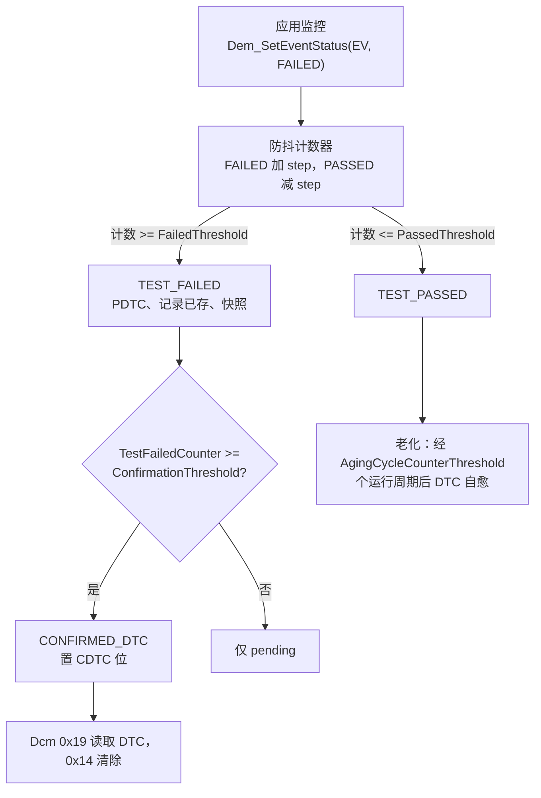
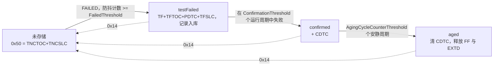

# Dem - 诊断事件管理（DTC 存储）

> **一句话概括：** 应用向 Dem 上报事件通过/失败；Dem 经防抖后生成 UDS 状态字节，
> 把 DTC 连同冻结帧与扩展数据存入事件内存，并供 Dcm 读取（0x14 / 0x19）。

| 项目 | 值 |
| --- | --- |
| 模块 | `infras/diagnostic/Dem`（API：`infras/include/Dem.h`） |
| 层级 | 下方是 Dcm（0x14/0x19），上方是应用监控逻辑 |
| 配置 | `app/app/config/Dcm/Dem.json` |
| 生成器 | `tools/generator/Dem.py` -> `GEN/Dem_Cfg.c` / `GEN/Dem_Cfg.h` |
| 标准 | AUTOSAR CP 4.4 Dem（子集） |
| 演示 | `CanApp` - 例程 `31 01 DEED`（`Dem_TestStart`）触发一个模拟事件 |

**目录**

1. [模块用途](#1-模块用途)
2. [运行时行为](#2-运行时行为)
3. [状态与冻结帧数据管理](#3-状态与冻结帧数据管理)
4. [配置](#4-配置)
5. [公开 API](#5-公开-api)
6. [构建与运行演示](#6-构建与运行演示)
7. [关键注意事项](#7-关键注意事项)
8. [故障排查](#8-故障排查)

---

## 1. 模块用途

* **事件状态跟踪** - `Dem_SetEventStatus(EventId, PASSED/FAILED/...)` 输入到基于
  计数器的防抖状态机。
* **DTC 存储** - 某 DTC 的首次测试失败边沿使其进入 pending 时就写入一个或多个
  事件内存（Primary、Mirror），连同状态字节、发生计数与老化信息；之后的确认只是
  补上 CDTC 位（见 3.3 节）。
* **冻结帧** - 故障发生时刻所配置环境数据的快照。
* **扩展数据** - 每个 DTC 的附加记录（如发生计数），由应用回调填充。
* **DTC 服务后端** - 清除 DTC（0x14）、读 DTC（0x19 各子功能）、DTC 设置控制
  （0x85）。

它**不做**的事：不做总线 IO（唯一客户端是 Dcm），不做监控算法（通过/失败由应用
判断）。

### 1.1 多个事件归并到一个 DTC

配置的主体是**DTC 表**：每个 `DTCs[]` 条目拥有一个**事件**列表（`Events[]`），而
被存储、被上报、被清除的对象始终是 DTC —— 事件只是能把该 DTC 置位的监控。

| 层 | 生成的符号 | 数量 | 承载内容 |
| --- | --- | --- | --- |
| 事件 | `DEM_EVENT_ID_<name>`、`Dem_EventConfigs[]`、`Dem_EventStatusRecords[]` | 每个 `Events[]` 条目一个 | 防抖计数器、事件级 UDS 状态字节、确认计数 |
| DTC | `Dem_Dtcs[]`（`EventIdRefs[]`、`NumOfEvents`、`DtcId`） | 每个 `DTCs[]` 条目一个 | DTC 号、severity、内存目标、DTC 级状态字节、发生/老化计数、冻结帧与扩展数据 |

* 单事件 DTC 就是退化情形 `Events: [{Name: X}]`：只有一个监控，事件边沿与 DTC
  边沿重合。
* **组合 DTC**（演示里的 `DTC_COMB0`，3 个事件）仍然只是**一个** DTC 条目。每个
  事件各自防抖，DTC 字节由它的事件**按位或**得出（`Dem_UpdateDtcStatus()`，
  @SWS_Dem_00441）：

```c
for (i = 0; i < dtcRef->NumOfEvents; i++)
  status |= EventStatusRecords[dtcRef->EventIdRefs[i]]->Status;
```

  因此只要**任一**事件失败，该 DTC 就进入 pending；只要**任一**事件被确认，该 DTC
  就被确认；而恢复只有在**全部**事件都通过后才在 DTC 层可见
  （`Dem_EventUpdateOnPass()`）。冻结帧、扩展数据、发生计数与
  老化计数都是按 DTC 的，所以组合 DTC 只有**一份**快照和**一条**老化历史 ——
  按事件的差异只存在于事件级状态字节里。
* 0x19 每个 `DTCs[]` 条目回报一行（绝不按事件回报），0x14 一次清掉该 DTC 的
  全部事件。
* 事件 id 按 JSON 顺序编号（先 DTC、再 `Events[]` 顺序），因此调整 JSON 顺序会
  静默改变 `DEM_EVENT_ID_*` 的编号（见第 7 节）。

### 1.2 `Dem.c` 的代码主线

| 关注点 | 入口 | 主要辅助函数 |
| --- | --- | --- |
| 启动 / NvM 恢复 | `Dem_Init()` —— `Dem_PreInit()` 是空桩，NvM 自己恢复各块 | `Dem_EventInit()`、`Dem_DtcOrderQueueInit()` |
| 上报与防抖 | `Dem_SetEventStatus()` | `Dem_SetEventStatusDebounce()`、`Dem_EventUpdateOnFailed()` / `_OnPass()` |
| 事件 -> DTC 归并 | `Dem_UpdateDtcStatus()` | 对 `EventIdRefs[]` 求或 + TNCSLC/TNCTOC 两处互斥修正 |
| 存储、计数、快照 | `Dem_DtcUpdateOnFailed()` | `Dem_TrigerStoreFreezeFrame()`、`Dem_TrigerStoreExtendedData()`、`Dem_HandleDtcDisplacement()` |
| 冻结帧 / 扩展数据池 | `Dem_MallocFreezeFrameRecord()`、`Dem_MallocExtendedDataRecord()` | `Dem_GetNextRecordNumber()`、`Dem_FillSnapshotRecord()`、`Dem_FreeFreezeFrameRecord()` |
| 运行周期与老化 | `Dem_SetOperationCycleState()`、`Dem_RestartOperationCycle()` | `Dem_StartOperationCycle()`、`Dem_StopOperationCycle()`、`Dem_DtcUpdateOnOperationCycleStop()` |
| 供 Dcm 0x19 读取 | `Dem_SetDTCFilter()`、`Dem_GetNextFilteredDTC()` | `Dem_IsFilteredDTC()`、`...AndFDC`、`...AndSeverity`、`Dem_GetNextFilteredRecord()` |
| 清除（0x14） | `Dem_ClearDTC()` | 释放 FF/EXTD 槽位、状态记录复位为 `0x50`、重初始化监控 |
| 发生顺序（3.7） | `Dem_GetDTCAndStatusByOccurrenceTime()` | `Dem_FailedOrderQueueInsert()`、`Dem_ConfirmedOrderQueueAppend()`、`Dem_DtcOrderQueueRemove()` |
| 持久化 | cared 位变化时 `NvM_WriteBlock()` | 每条记录一个 NvM 块（3.5） |

---

## 2. 运行时行为



* **运行周期**（`IGNITION` 等）门控老化与发生计数：
  `Dem_RestartOperationCycle()` / `Dem_SetOperationCycleState()`。
* **使能条件**（JSON 的 `Conditions`，如 `BatteryNormal`）必须先经
  `Dem_SetEnableCondition()` 上报 `TRUE`，事件才会被处理。
* **存储条件并未实现**：`Dem_SetStorageCondition()` 只在 `Dem.h` 中声明，没有实现，当前没有任何东西门控内存写入。
* **DTC setting**（`0x85` -> `Dem_DisableDTCSetting()` / `Dem_EnableDTCSetting()`）
  是唯一存在的门：禁用期间每个 `Dem_SetEventStatus()` 直接返回 `E_NOT_OK`，不触碰
  任何记录（`Dem.c:1652`）。
* **DTC 级边沿**（TF 0->1、CDTC 0->1）同时做三件事：更新 DTC 状态字节、存储 /
  捕获数据、给回答 0x19 0x0B-0x0E 的发生顺序队列打戳（3.7 节）。

---

## 3. 状态与冻结帧数据管理

Dem 维护**四类记录**，全部由生成器静态分配 —— 没有任何动态分配。生成器生成
数组与 NvM 块表；运行时代码只在这些记录内部搬移状态位与计数器。0x19 0x01/0x02
读的是 DTC 状态记录，0x19 0x04 读冻结帧子槽，0x19 0x06 读扩展数据；0x14 清除
该组并释放其槽位。

### 3.1 记录分层

| 记录 | 数量 | 字段 | 持久化 |
| --- | --- | --- | --- |
| `Dem_EventStatusRecordType` | 每个**事件**一条（`DTC_ENVENT_NUM`） | `Status`（UDS 字节）、`TestFailedCounter`（每发生一次事件级 TF 0->1 边沿加一，在本周期无失败的周期停止时清零；`>= ConfirmationThreshold` 时置 CDTC） | 每事件一个 NvM 块（2 字节） |
| `Dem_DtcStatusRecordType` | 每个 **DTC × 内存**一条（Primary、Mirror） | `Status`（聚合值）、`FaultOccurrenceCounter`、`AgingCounter`、`AgedCounter`（启用时另有 `CyclesSinceLastFailed`） | 每 DTC 每内存一个 NvM 块（4 字节） |
| `Dem_FreezeFrameRecordType` | 每内存一个池，数组大小 `min(NumOfDtcs, DEM_MAX_FREEZE_FRAME_RECORD)` —— 默认每个 DTC 一个槽位（`DEM_MAX_FREEZE_FRAME_RECORD` 默认等于**事件**数） | `DtcId` + `MaxFreezeFrameNum` 个子槽 `[记录号, 快照字节]` | 每槽一个 NvM 块（此处 2 + `MaxNum` × 13 字节） |
| `Dem_ExtendedDataRecordType` | 同样的池容量规则 | `DtcId` + `[记录号, 扩展数据字节]` | 每槽一个 NvM 块 |

`Dem_EventContextType`（防抖后的监控状态、`DebounceCounter`、抓取标志）与
`demContext`（DTC 过滤器、使能条件、DTC setting 状态）**只存在于 RAM**：在运行
周期启动时重建，被 `Dem_Init()` 和 0x14 清零。

### 3.2 一个状态字节，两层归属

**事件级**字节由防抖迁移所触发的事件处理函数写入（`Dem_EventUpdateOnFailed()` /
`Dem_EventUpdateOnPass()`，第 2 节）；只有它知道哪个监控最终通过或失败。

**DTC 级**字节在该 DTC 的任一事件变化时由 `Dem_UpdateDtcStatus()`
（@SWS_Dem_00441）重新计算：

```c
status = 0;
for each event of the DTC: status |= EventStatus->Status;
if (status & TFSLC) status &= ~TNCSLC;   /* "自清码以来失败过" 与 "自清码未完成" 互斥 */
if (status & TFTOC) status &= ~TNCTOC;   /* 本运行周期同理 */
StatusRecord->Status = status;           /* 0x19 0x01/0x02 上报的就是这个字节（会被掩码） */
```

即 DTC 字节是其全部事件状态的按位或，外加两条互斥修正；组合 DTC 中任一事件
确认即整条 DTC 确认。

| 位 | 名称 | 置位者 | 清位者 |
| --- | --- | --- | --- |
| 0x01 | testFailed (TF) | 防抖计数到达 `FailedThreshold` | 防抖到达 `PassedThreshold`、运行周期启动（除非定义 `DEM_STATUS_BIT_STORAGE_TEST_FAILED`）、0x14 |
| 0x02 | testFailedThisOperationCycle (TFTOC) | 同上 | 仅由运行周期启动清除 —— PASSED 上报不会清它，所以该周期仍算失败过 |
| 0x04 | pendingDTC (PDTC) | 同上 | 本周期无失败的周期停止、0x14 |
| 0x08 | confirmedDTC (CDTC) | `TestFailedCounter >= ConfirmationThreshold` | 老化完成、0x14 |
| 0x10 | testNotCompletedSinceLastClear (TNCSLC) | 初始化、0x14 | 任一 FAILED 上报 |
| 0x20 | testFailedSinceLastClear (TFSLC) | 任一 FAILED 上报 | 0x14、老化完成（`DEM_STATUS_BIT_HANDLING_TEST_FAILED_SINCE_LAST_CLEAR == AGING_AND_DISPLACEMENT`） |
| 0x40 | testNotCompletedThisOperationCycle (TNCTOC) | 运行周期启动 | 任一 FAILED 上报 |
| 0x80 | warningIndicatorRequested (WIR) | 本子集未维护 | - |

### 3.3 一条 DTC 的生命周期



1. **上报** - `Dem_SetEventStatus()` 进入计数器防抖；到达 `FailedThreshold` 后
   调用 `Dem_EventUpdateOnFailed()`（@SWS_Dem_01199/01207）。
2. **事件字节** - 置 TF | TFTOC | PDTC | TFSLC，清 TNCTOC | TNCSLC，
   `TestFailedCounter` 加一；达到确认阈值后加 CDTC；有变化则写该事件的 NvM 块。
3. **DTC 字节** - 对 `Destination[]` 中的**每一个**内存执行
   `Dem_DtcUpdateOnFailed()`：`AgingCounter = 0`，按 `OccurrenceCounterProcessing`
   累计发生计数，按 `FreezeFrameRecordTrigger` 抓取快照；有变化则写该 DTC 的
   NvM 块。
4. **恢复** - PASSED 上报清事件上的 TF、TNCTOC、TNCSLC（TFTOC 保留到下次运行
   周期启动，因此本周期仍记为失败过）；只有该 DTC 的**全部**事件都通过后才重算
   DTC 字节（`Dem_EventUpdateOnPass`）。
5. **老化** - 运行周期停止时，若 DTC 字节中既无 TFTOC 也无 TNCTOC（本周期无
   失败）则清 PDTC；若为 CDTC 且 `AgingAllowed`，每个安静周期 `AgingCounter++`；
   到达 `AgingCycleCounterThreshold` 后清 CDTC，复位发生/老化计数，
   `AgedCounter++`，并**释放**该 DTC 的冻结帧与扩展数据记录
   （@SWS_Dem_00498/01075）。
6. **清除** - `Dem_ClearDTC()`（0x14）把命中的 DTC 状态记录清成 `0x50`
   （TNCTOC | TNCSLC），清零事件上下文，把事件记录也置成 `0x50` 且
   `TestFailedCounter = 0`，释放该组的冻结帧与扩展数据槽位，并对每个事件调用
   `DemCallbackInitMForE(DEM_INIT_MONITOR_CLEAR)`。

### 3.4 冻结帧池

* **静态池，默认每个 DTC 一个槽位。** 每内存的槽位数 =
  `min(NumOfDtcs, DEM_MAX_FREEZE_FRAME_RECORD)`（`DEM_MAX_FREEZE_FRAME_RECORD`
  默认等于事件数，因此就是一个 DTC 一个）。按 `Priority` 的淘汰逻辑存在，但只有把
  池故意配得比 DTC 表小才会触发。
* **分配**（`Dem_MallocFreezeFrameRecord`）：复用该 DTC 已有的槽位 -> 否则取
  第一个空闲槽（`DtcId == 0xFFFF`）-> 否则淘汰优先级最低的 DTC
  （且在 `DEM_RESET_CONFIRMED_BIT_ON_OVERFLOW` 下清它的 PDTC/CDTC）。
* **子槽**：每个 DTC 最多 `MaxFreezeFrameNum`（演示为 2）条记录。新记录取第一
  个空闲子槽；全部占满时**覆盖最后一个**，即最新快照胜出，不维护环形计数。
* **记录号**：始终生成 `DEM_FF_RECNUM_CONFIGURED` 模式，记录号来自
  `FreezeFrameRecNums`（默认 `1..MaxFreezeFrameNum`），占满后重复使用列表最后
  一个号。`Dem_GetNextRecordNumber()` 也能算 `numOfRecs + 1`，但生成的配置从不
  选择该模式。
* **快照内容**：`FreezeFrameData[slot][0]` 是记录号；其余是该 DTC `Environments`
  的**原始值**（DTC 级 `Environments[]` 覆盖全局列表），按 `Id` 升序存放，固定
  大小 `DEM_MAX_FREEZE_FRAME_DATA_SIZE`。2 字节 DID 是读取时由
  `Dem_FillSnapshotRecord()` **补上的** —— 所以 0x19 0x04 每条记录要
  `4 + Sum(2 + size)` 字节，而存储只需 `1 + Sum(size)`。
* **时机**：`FreezeFrameRecordTrigger` = `TEST_FAILED`（TF 0->1）、`PENDING`
  （PDTC 0->1）、`CONFIRMED`（CDTC 0->1）或 `EVERY_TEST_FAILED`。抓取都在
  `Dem_SetEventStatus()` 内同步完成：生成器写死
  `EnvironmentDataCapture = DEM_CAPTURE_SYNCHRONOUS_TO_REPORTING`，没有对应 JSON
  键。延期路径（`DEM_EVENT_FLAG_CAPTURE_FF` 由 `Dem_MainFunction()` 执行，
  @SWS_Dem_00461）代码里有，但没有任何配置会选择它。
* **释放**：老化完成、0x14、或被淘汰。触发条件从未命中的 DTC 不会持有快照，
  即使已确认，0x19 0x04 也无内容可报。
* 扩展数据遵循完全相同的池规则，`ExtendedData[0]` 为记录号，触发为
  `ExtendedDataRecordTrigger`。

### 3.5 持久化规则

NvM 块写入的判据是“记录是否重要了”，而不是“什么内容变了”：

```c
/* Dem_Priv.h —— 除非定义 DEM_STATUS_BIT_STORAGE_TEST_FAILED，
 * DEM_NVM_STORE_TEST_FAILED 为 0 */
#define DEM_NVM_STORE_CARED_BITS \
  (PDTC | CDTC | TNCSLC | TFSLC | WIR | DEM_NVM_STORE_TEST_FAILED)
...
if ((oldStatus & DEM_NVM_STORE_CARED_BITS) != (StatusRecord->Status & DEM_NVM_STORE_CARED_BITS))
  NvM_WriteBlock(...);   /* 整块写入，计数器随之一起持久化 */
```

改动记录布局之前值得知道的推论：

* TF（位 0）只在定义 `DEM_STATUS_BIT_STORAGE_TEST_FAILED` 时才入库；TNCTOC
  （位 6）从不参与比较。两者都由运行周期启动路径恢复（置 TNCTOC、清 TF）。
* `FaultOccurrenceCounter`、`AgingCounter`、`AgedCounter` 同样不参与比较：只有
  同一次更新中有其它关心的位变化（或老化完成时显式置脏）才会随块持久化。
* 每记录一个块 -> 一次失败 = 1 次事件块写 + `NumOfMemoryDestination` 次 DTC 块
  写 + 可选 1 次冻结帧写 + 1 次扩展数据写。没有“整内存镜像”块。
* 块长度**不是** `sizeof(Dem_...RecordType)`。`NvM.json` 逐字段（`Data[]`）描述
  每个块，NvM 生成器据此生成自己的 `Dem_Nvm...Type` 结构体，`NvM_Cfg.c` 用
  **该类型**的 `sizeof()` 作为块长度，而指针指向的是 Dem 的记录对象（`extern
  Dem_DtcStatusRecordType Dem_NvmPrimaryDtcStatusRecord0_Ram;`）。因此给
  `Dem_DtcStatusRecordType` 加字段**不会**改变块布局 —— 必须同步手改 `NvM.json`
  里对应的条目，否则同一片 RAM 的两种视图在长度上不一致。任何布局变更也会使按旧
  布局刷写的 ECU 内容失效。

### 3.6 存储数据回答不了的问题

当诊断功能需要“第一条 / 最近一条” DTC 时，记住以下几点：

1. **记录里没有时基，也没有发生顺序。** `Dem_DtcStatusRecordType` 只有一个状态字节加
   三个计数器 —— 没有时间戳、没有全局序号、没有“上次失败是什么时候”。
   `Dem.c` 本身也不依赖任何时间源。
2. **记录里唯一存在的顺序是配置顺序。** `Dem_GetNextFilteredDTC()` 按
   `demContext.Filter.Index .. NumOfDtcs-1` 遍历，即 `Dem.json` 中 `DTCs[]` 的
   顺序。“下标最小/最大”是稳定的，但与故障发生时间无关（发生顺序在 3.7 节那
   两条独立队列里）。
3. **状态字节是快照，不是历史。** DTC 恢复后只有 TFSLC（位 5）还能证明“自上次
   清码失败过”；TF 与 PDTC 已消失。老化或 0x14 之后连 TFSLC 也没有了。因此
   first/most-recent 查询无法事后从记录中反推 —— 信息必须在状态迁移发生时捕获。
4. **记录本身回答不了“第一条 / 最近一条”—— 由单独的队列回答。**
   `Dem_GetDTCByOccurrenceTime()`（@SWS_Dem_00218）建立在两条有序 DtcId 队列
   之上（3.7 节），并不去翻状态记录：队列在 TF / CDTC 0->1 边沿打戳，并存放于
   自己的 NvM 块中。特性关闭、或对应队列为空时，Dcm 以
   `requestOutOfRange`（0x31）拒绝 0x0B-0x0E，而不再按配置顺序编一个答案。
5. **冻结帧池按 DTC 索引，不按时间。** 槽位顺序与记录号都是每 DTC 的（“该 DTC
   的第 1、2 条快照”），都不能用来排序不同 DTC。
6. **`AgedCounter` 与 `FaultOccurrenceCounter` 是单调计数器，不是时钟。** 可以
   按次数排名，不能按新旧排名。
7. **代码中唯一区分“发生过”与“当前激活”的位置**是 `Dem_DtcUpdateOnFailed()` 中
   TF 0->1 的边沿及其下方的 CDTC 0->1 边沿 —— 发生顺序队列正是在这里打戳
   （3.7 节）。

### 3.7 0x19 0x0B-0x0E 的发生顺序跟踪

四个“第一条 / 最近一条”服务由两条有序的 **DtcId 队列**回答：队列在 DTC 级边沿
打戳，而不是去翻 3.6 里那些没有时基的状态记录。

真实的时间线只有两条 —— DTC **失败**的先后，以及被**确认**的先后。0x19 的四个
结果只是这两条时间线的表头 / 表尾视图，所以数据模型是两条队列而不是四条列表，
并且各有独立的编译开关。

“first failed”与“most recent failed”在出现重失败（失败 -> 恢复 -> 再失败）时
需要**两种不同的排序**，单条队列装不下。解决办法是**历史队列**：每条 TF 0->1
边沿按时间顺序记录，并且每个 DTC 只保留**两条**边沿 —— 它的**首次**与**最近
一次**（两者重合时只占一条）。于是表头永远是第一个失败的 DTC，表尾永远是最新
失败的那个。

以 TF 边沿 `D1 D2 D1 D2 D1` 为例，队列逐步演化为（`0xFFFF` 是第一个空条目 =
结束标记）：

| TF 0->1 边沿 | Q1 内容（表头 ... 表尾） | 原因 | 0x0B | 0x0D |
| --- | --- | --- | --- | --- |
| `D1` | `D1` | 尚未跟踪 -> 追加 | D1 | D1 |
| `D2` | `D1 D2` | 尚未跟踪 -> 追加 | D1 | D2 |
| `D1` | `D1 D2 D1` | 只有一条（首次 = 最近）-> 追加 | D1 | D1 |
| `D2` | `D1 D2 D1 D2` | 只有一条（首次 = 最近）-> 追加 | D1 | D2 |
| `D1` | `D1 D2 D2 D1` | 已有两条 -> 擦除陈旧的那条“最近”，再追加 | D1 | D1 |

因此表头永远是最早存活的边沿（= 第一个失败），表尾是最新的边沿（= 最近一次
失败）；同一 DTC 在两者重合时占一条，之后占两条。Q2（确认序）是平凡情况：CDTC
0->1 边沿对每个 DTC 只可能发生一次，所以就是容量 `NumOfDtcs` 的单纯追加。

#### 数据模型

`Dem_Priv.h` 中的 `Dem_DtcOrderQueueConfigType` —— 队列是指向 NvM Ram 块的
指针，容量由 NvM 配置决定：

```c
/* Dem_Priv.h */
#if defined(DEM_USE_FAILED_DTC_ORDER_QUEUE) || defined(DEM_USE_CONFIRMED_DTC_ORDER_QUEUE)
typedef struct {
#ifdef DEM_USE_FAILED_DTC_ORDER_QUEUE
  CONSTP2VAR(uint16_t, AUTOMATIC, DEM_CONST)
  FailedOrderQueue;                        /* 2 * NumOfDtcs 条 */
  uint16_t FailedOrderQueueNvmBlockId;
#endif
#ifdef DEM_USE_CONFIRMED_DTC_ORDER_QUEUE
  CONSTP2VAR(uint16_t, AUTOMATIC, DEM_CONST)
  ConfirmedOrderQueue;                     /* NumOfDtcs 条 */
  uint16_t ConfirmedOrderQueueNvmBlockId;
#endif
} Dem_DtcOrderQueueConfigType;
#endif
```

* 两个实例：**Q1 失败序队列**（`2 * NumOfDtcs` 条）与 **Q2 确认序队列**
  （`NumOfDtcs` 条），各占一个 NvM 块。
* **不需要 Count 字段。** 块的默认值即为全 `0xFFFF`，未动过的块就是空队列；第一个
  `0xFFFF` 条目即有效部分的结束标记（表头 = 下标 0，表尾 = 结束标记前最后一个
  条目）。
* Q1 不变式：条目按 TF 0->1 边沿的时间顺序排列，且每个已存储的 DtcId **至多
  两条** —— 它的首次与最近一次失败边沿；出现第三条时擦除中间那条陈旧记录。
  组合 DTC 在 **DTC 级**状态边沿打戳，绝不按事件重复打戳。

#### 更新规则

| 对象 | 更新点 | 已存在时 | 服务 |
| --- | --- | --- | --- |
| Q1 失败序 | `Dem_DtcUpdateOnFailed()` 里的 TF 0->1 边沿 -> `Dem_FailedOrderQueueInsert()` | 0 条：追加；1 条（首 = 末）：再追加（成为首 + 末）；2 条：擦除末次条目并追加到尾部 | 0x0B first failed = 表头，0x0D most recent failed = 表尾 |
| Q2 确认序 | CDTC 0->1 边沿 -> `Dem_ConfirmedOrderQueueAppend()` | 不可能发生 —— 该边沿意味着 DTC 之前未被确认 | 0x0C first confirmed = 表头，0x0E most recent confirmed = 表尾 |

两个边沿都只在**第一个配置的内存目标**上打戳（`Dem_DtcUpdateOnFailed()` 里的
`0u == origin`），即一个 DTC 即使同时存 Primary 与 Mirror 也只打一次。

**为什么 `2 * NumOfDtcs` 的容量永不溢出：** 队列占用等于各 DTC 的
`min(失败边沿数, 2)` 之和 `<= 2 * NumOfDtcs`。一条边沿至多让该和加一，2->2 条的
转变占用不变，因此追加永远不会被拒收 —— `Dem_OrderQueueAppend()` 不需要“队列
已满”的错误分支。

**重失败不能原地覆盖末次槽位** —— 那会破坏时间顺序（在
`[D1@t1, D2@t2, D1@t3, D2@t4]` 中原地覆盖会把陈旧的表尾留在末尾）。
`Dem_FailedOrderQueueInsert()` 先用 `Dem_OrderQueueRemoveAt()` 从中间擦除末次
条目，再追加到尾部。

**移除规则（本设计的关键性质）：** 只要某 DTC 的存储状态被擦除，其 DtcId 的
**全部**条目就从**两条队列**中移除，其余条目保持相对顺序 —— 次序上紧随其后的
条目自动成为新的 first / most recent。`Dem_DtcOrderQueueRemove()` 的调用点：

* 老化完成（@SWS_Dem_00498/01075），
* `Dem_ClearDTC()`（0x14），按命中的 DTC 逐条移除，
* 导致 CDTC 复位的置换（`DEM_RESET_CONFIRMED_BIT_ON_OVERFLOW`）。

#### 读取

`Dem_GetDTCAndStatusByOccurrenceTime(clientId, kind, *DTC, *status)` 把 kind 映射
到 Q1 表头（0x0B）、Q1 表尾（0x0D）、Q2 表头（0x0C）或 Q2 表尾（0x0E），并同时
返回该 DTC 当前的 UDS 状态字节 —— 取自 **Primary** 内存记录（没有 Primary 时取
第一个内存），且不做 `StatusAvailabilityMask` 掩码；`Dem_GetDTCByOccurrenceTime()`
（@SWS_Dem_00218）是它的标准薄封装。返回值：

| 情形 | 返回 |
| --- | --- |
| 队列有答案 | `E_OK`，DTC 与状态已填充 |
| 对应队列为空 | `DEM_NO_SUCH_ELEMENT` |
| 特性未编译进来 | `E_NOT_OK` |
| 传入 `NULL` 指针 | `E_NOT_OK` |

`Dcm_DspReportFirstOrMostRecentDTC()` 只从这里取答案 —— 不再有配置序兜底：任何
失败（`DEM_NO_SUCH_ELEMENT` 或 `E_NOT_OK`）都以 `requestOutOfRange`（0x31）回报
测试端，长度不对报 `0x13`，响应缓冲不足报 `0x14`（`responseTooLong`）。

#### 配置

| JSON 键（`Dem.json`） | 生成的宏 | 默认 | 服务 |
| --- | --- | --- | --- |
| `UseFailedDtcOrderQueue` | `DEM_USE_FAILED_DTC_ORDER_QUEUE` | `false` | Q1 -> 0x19 0x0B / 0x0D |
| `UseConfirmedDtcOrderQueue` | `DEM_USE_CONFIRMED_DTC_ORDER_QUEUE` | `false` | Q2 -> 0x19 0x0C / 0x0E |

某个开关关闭时，生成器不产生该队列以及 `Dem_DtcOrderQueue` 中对应成员（`NvM.json`
里的块也一并去掉），因此不占 RAM，其对应的 0x19 服务回报 `0x31`。

**NvM 集成**（通用规则见 3.5）：

* `NvM.json` 中两个块 —— `Dem_NvmDtcFailedOrderQueue`（`2 * NumOfDtcs` ×
  `uint16`）与 `Dem_NvmDtcConfirmedOrderQueue`（`NumOfDtcs` × `uint16`），默认值
  都是 `[0xFFFF]*n`。这两个条目是**手写**的：Dem 生成器只消费它们、不创建，新增
  DTC 时必须手动跟随 `NumOfDtcs` 改 `Repeat`（演示 6 个 DTC -> `Repeat: 12` 与
  `Repeat: 6`）。
* 变化即写：每次追加 / 擦除后追加 / 移除都用生成的 `Dem_DtcOrderQueue` 里的
  块 id 发一次 `NvM_WriteBlock()`。
* `Dem_Init()` -> `Dem_DtcOrderQueueInit()` 校验恢复出来的内容
  （`Dem_OrderQueueIsValid()`）：有效部分里的 id 都在范围内（`< NumOfDtcs`），
  且在 Q1 中至多出现两条（Q2 至多一条）；第一个 `0xFFFF` 之后的内容被忽略。
  内容损坏时整体复位为 `0xFFFF` 并打一条 `DEME` 日志 —— 这份历史没有别处可以
  重建。复位只发生在 NvM Ram 映像里：块本身要等下一次队列更新才被重写，因此
  损坏的映像会每次启动都记一条日志，直到有变化把它覆盖。
* 与任何记录布局变更一样，启用该特性会使按旧布局刷写的 ECU 内容失效。

**与标准严格措辞的有意偏差：**

1. **老化会移除条目。** ISO 14229-1 把答案范围限定为“自上次清码以来”，因此已
   老化的 DTC 仍应是答案；这里的答案变成“仍然存储着的最早 / 最新 DTC”，从而与
   0x19 0x02/0x0A 实际报出的内容保持一致。
2. **队列是全局的，不按内存目标划分。** 发生时间不是“每个内存”的概念，0x19
   0x0B-0x0E 也不带 DTCOrigin。
3. **关闭时零开销。** 两个开关都关 = 除 0x0B-0x0E 改答 `0x31`（而不再是配置下标）
   之外，与原有行为一致。

---

## 4. 配置

### 4.1 顶层键

| 键 | 默认值 | 含义 |
| --- | --- | --- |
| `Memories[]` | `[{Name: Primary, Origin: 0x0001}]` | 事件内存；`Origin` 是 0x19 使用的 DTCOrigin（1=Primary，2=Mirror...） |
| `General` | 见 4.2 | 防抖/老化/确认策略 |
| `DTCs[]` | 必填 | DTC 表（见 4.3） |
| `Environments[]` | 必填，可为 `[]` | 冻结帧（FFD）数据记录 —— 生成器直接按该键取值 |
| `ExtendedDatas[]` | 必填，可为 `[]` | 扩展数据（EXTD）记录，同样 |
| `MaxFreezeFrameNum` | **2** | 每个 DTC 的冻结帧记录数 |
| `StatusAvailabilityMask` | **0x7F** | 支持哪些 UDS 状态位 |
| `UseFailedDtcOrderQueue` | **false** | 生成 `DEM_USE_FAILED_DTC_ORDER_QUEUE`：Q1，服务 0x19 0x0B / 0x0D（3.7 节） |
| `UseConfirmedDtcOrderQueue` | **false** | 生成 `DEM_USE_CONFIRMED_DTC_ORDER_QUEUE`：Q2，服务 0x19 0x0C / 0x0E（3.7 节） |
| `UsePostBuildConfig` | **false** | 生成 `DEM_USE_PB_CONFIG` |

### 4.2 `General`

| 键 | 演示值 | 含义 |
| --- | --- | --- |
| `DebounceCounterFailedThreshold` | 10 | 置 TEST_FAILED 的计数值 |
| `DebounceCounterPassedThreshold` | -10 | 置 TEST_PASSED 的计数值 |
| `DebounceCounterIncrementStepSize` / `DecrementStepSize` | 1 / 2 | 每次 FAILED / PASSED 上报的步进 |
| `DebounceCounterJumpDown` / `JumpDownValue` | false / 0 | 通过时直接跳到某值 |
| `DebounceCounterJumpUp` / `JumpUpValue` | true / 0 | 失败时直接跳到某值 |
| `ConfirmationThreshold` | 2 | DTC 取得 CDTC 前需要的失败上报次数（TF 0->1 边沿）—— 实践上每个失败周期一次，但同一周期内再次失败会再计一次 |
| `AgingCycleCounterThreshold` | 5 | 确认 DTC 老化清除前需通过的运行周期数 |
| `OccurrenceCounterProcessing` | `"TF"` | 在 TEST_FAILED 时累计发生计数 |
| `FreezeFrameRecordTrigger` | `"TEST_FAILED"` | 何时抓取冻结帧 |
| `ExtendedDataRecordTrigger` | `"TEST_FAILED"` | 何时更新扩展数据 |

### 4.3 `DTCs[]`

| 键 | 含义 |
| --- | --- |
| `Name` | 符号名 - 生成 `DEM_EVENT_ID_<NAME>`；组合 DTC 经 `Events[]` 包含多个事件 |
| `Number` | 3 字节 DTC 编号，如 `"0x112200"` |
| `Conditions` | 使能条件名；所有名字的并集生成 `DEM_NUM_OF_ENABLE_CONDITION` |
| `Destination` | 存入哪些内存，如 `["Primary", "Mirror"]` |
| `Priority` | 数值越小优先级越高；只在冻结帧 / 扩展数据池满时用于挑选被淘汰者 |
| `OperationCycleRef` | 周期名，默认 `IGNITION` |
| `Events[]` | 组合 DTC 的子事件（演示中的 `DTC_COMB0`） |
| `Environments` / `FreezeFrameRecNums` | 按 DTC 覆盖冻结帧内容/记录号 |

### 4.4 `Environments[]` / `ExtendedDatas[]`

每条记录是 `{Name, Id, Type, Unit?}`（`uint8`/`uint16`...）。对每条记录，生成器
会**声明一个应用必须实现的回调**：

```c
Std_ReturnType Dem_FFD_GetBattery(Dem_DtcIdType EventId, uint8_t *data, Dem_DTCOriginType DTCOrigin);
Std_ReturnType Dem_EXTD_GetFaultOccuranceCounter(Dem_DtcIdType EventId, uint8_t *data, Dem_DTCOriginType origin);
```

缺实现是链接错误；`Type` 大小写错会破坏记录布局。

---

## 5. 公开 API

| 函数 | 调用方 | 用途 |
| --- | --- | --- |
| `Dem_Init(ConfigPtr)` | EcuM | 激活配置、重初始化事件并校验顺序队列。`Dem_PreInit()` 是空桩，`Dem_Shutdown()` 未实现 |
| `Dem_SetEventStatus(EventId, status)` | 应用监控 | 上报 `PASSED` / `FAILED` / `PREPASSED` / `PREFAILED` |
| `Dem_SetEnableCondition(id, bool)` | 应用 | 上报 `BatteryNormal` 等 |
| `Dem_SetOperationCycleState` / `Dem_RestartOperationCycle(id)` | 应用 / EcuM | 驱动 `IGNITION` 周期 |
| `Dem_GetEventUdsStatus(EventId, *byte)` | 应用 | 当前 UDS 状态字节 |
| `Dem_GetFaultDetectionCounter(EventId, *counter)` | 应用 | 线性映射到 UDS 范围 -128..127 的故障检测计数器（`Dem_GetFDCOfDTC()` 对 DTC 做同样的事） |
| `Dem_SetDTCFilter` / `Dem_GetNumberOfFilteredDTC` / `Dem_GetNextFilteredDTC`（+ `AndFDC`、`AndSeverity`） | Dcm 0x19 | DTC 报告遍历 |
| `Dem_SetFreezeFrameRecordFilter` / `Dem_GetNumberOfFreezeFrameRecords` / `Dem_GetNextFilteredRecord` | Dcm 0x19/0x04 | 冻结帧遍历 |
| `Dem_SelectDTC` / `Dem_ClearDTC(ClientId)` | Dcm 0x14 | 在所选 origin 中清除 DTC |
| `Dem_SelectFreezeFrameData` / `Dem_GetNextFreezeFrameData` | Dcm 0x19/0x04 | 冻结帧读取 |
| `Dem_SelectExtendedDataRecord` / `Dem_GetNextExtendedDataRecord` | Dcm 0x19/0x06 | 扩展数据读取 |
| `Dem_DisableDTCSetting` / `Dem_EnableDTCSetting(ClientId)` | Dcm 0x85 | 停止/恢复事件存储 |
| `Dem_GetDTCStatusAvailabilityMask` | Dcm 0x19 | 状态可用性掩码 |
| `Dem_GetDTCByOccurrenceTime(ClientId, kind, *DTC)` / `Dem_GetDTCAndStatusByOccurrenceTime(..., *status)` | Dcm 0x19 0x0B-0x0E | 从发生顺序队列取第一条 / 最近一条失败或确认的 DTC（3.7 节） |
| `Dem_MainFunction()` | 调度器 | 只处理延期的冻结帧 / 扩展数据抓取标志 —— 这里不做防抖也不做老化（老化在运行周期停止时进行） |

---

## 6. 构建与运行演示

```bash
scons --app=CanApp
./build/nt/GCC/CanApp/CanApp.exe
./build/nt/GCC/IsoTpSend/IsoTpSend.exe -v 1902FF      # 按掩码 0xFF 读 DTC 状态
./build/nt/GCC/IsoTpSend/IsoTpSend.exe -v 3101DEED    # 例程：Dem_TestStart
./build/nt/GCC/IsoTpSend/IsoTpSend.exe -v 1902FF      # 此时 DTC 已存储
./build/nt/GCC/IsoTpSend/IsoTpSend.exe -v 14FFFFFF    # 清除全部 DTC
```

演示 DTC 是 `0x112200` ... `0x112204` 加组合 `DTC_COMB0`；例程 `0xDEED`
（`Dem_TestStart`）上报一个 FAILED 事件，可以完整观察：事件 -> 防抖 -> pending +
冻结帧 -> 确认 -> 0x19 报告 -> 0x14 清除。

---

## 7. 关键注意事项

1. **事件 id 由名字生成** - `DEM_EVENT_ID_DTC0` 等。应用包含 `Dem_Cfg.h` 并用这些
   宏上报；DTC 重新排序时编号会静默变化。
2. **组合 DTC 共享一个存储条目** - `Events[]` 的所有事件映射到同一个 DTC 编号；
   任一事件失败即更新 DTC 字节，任一事件确认即确认该 DTC。
3. **使能条件必须在启动时上报** - 配了 `conditions: ["BatteryNormal"]` 而不调
   `Dem_SetEnableCondition(0, TRUE)`，所有事件上报都会被忽略。
4. **老化按运行周期计，不按时间** - 在点火 off/on 时调用
   `Dem_RestartOperationCycle()`，否则确认的 DTC 永远不会老化。
5. **每条 FFD/EXTD 记录都必须有回调** - 生成器输出原型；演示实现位于
   `app/app/src`。
6. **内存由 NvM 支撑** - 经 NvM 配置的 `NvmBlock` 挂钩；NvM 不可用时内存只在 RAM
   （断电丢失）。
7. **`Priority` 影响溢出** - 内存满时被替换的是优先级最低的 DTC。

---

## 8. 故障排查

| 现象 | 可能原因 | 检查点 |
| --- | --- | --- |
| 事件在失败但 0x19 无 DTC | 使能条件未置位，或事件还在防抖中 | `Dem_SetEnableCondition`、`Dem_GetFaultDetectionCounter` |
| 0x14 清不掉 | DTC setting 被禁（0x85）或 DTCOrigin 不对 | `Dem_DisableDTCSetting` 状态、`Origin` |
| 冻结帧为空 | 未达到 `FreezeFrameRecordTrigger`，或 FFD 回调返回 E_NOT_OK | 回调返回值 |
| 链接错误 `Dem_FFD_GetX` | JSON 声明了记录但没实现 | 实现或删除记录 |
| 复位后 DTC 丢失 | NvM 未存储该内存块 | NvM.json 的块 id、NvM read-all 顺序（`Dem_PreInit()` 是空桩，那里什么都不读） |
| 组合 DTC 只显示一个事件 | `Events[]` 名字重复 | DTC JSON |

---

**相关文档：** [Dcm](Dcm.md) - [NvM](NvM.md) - [CanTp](CanTp.md)
