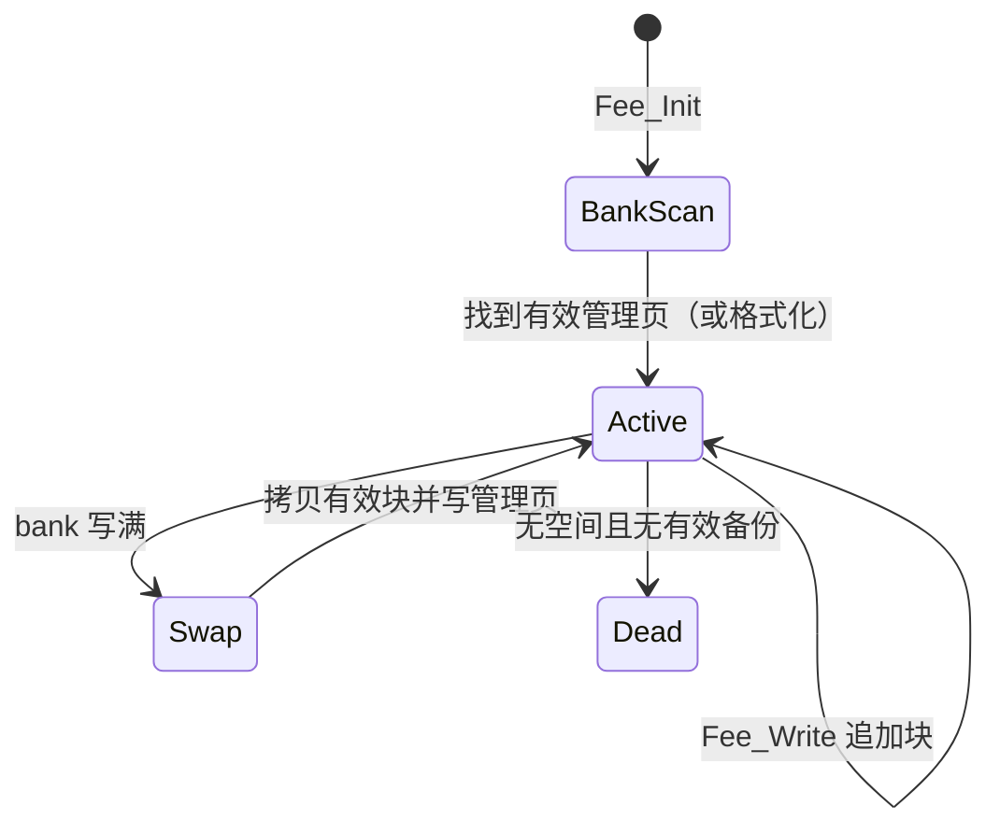

# Fee - Flash EEPROM 模拟

> **一句话概括：** Fee 在按页擦除的 Flash 上模拟可按字节写的 EEPROM：块带管理头
> 追加写入，写满后切换到下一个 bank（环形轮换），切换过程中回收旧副本。

| 项目 | 值 |
| --- | --- |
| 模块 | `infras/memory/Fee`（API：`infras/include/Fee.h`） |
| 层级 | Fls 之上，[NvM](NvM.md)（经 MemIf）之下 |
| 配置 | 由 `tools/generator/NvM.py` 生成到 `GEN/Fee_Cfg.c`（`Fee_Banks[]`），另加 `config/NvM/Fls_Cfg.c`（bank 地址） |
| 标准 | AUTOSAR CP 4.4 Fee（子集） |
| 演示 | `CanApp`，`target: Fee`，模拟器上启用 `FLS_DIRECT_ACCESS` |

**目录**

1. [模块用途](#1-模块用途)
2. [配置](#2-配置)
3. [运行时行为](#3-运行时行为)
4. [公开 API](#4-公开-api)
5. [关键注意事项](#5-关键注意事项)
6. [已知局限](#6-已知局限)

---

## 1. 模块用途

* **追加式块存储** - 每次写都在活跃 bank 的下一个空闲页追加 `{管理头, CRC, 数据}`；
  最新的副本生效。
* **Bank 切换** - 活跃 bank 写满后，把有效块拷到下一个 bank 并切换（环形轮换）；
  所有 bank 都满才会"Flash 报废"。
* **磨损分散** - 因为是追加写，频繁更新的小块不会磨损单一 Flash 页。
* **掉电安全** - bank/块管理结构带 magic 及其取反副本，每个块另有自己的数据
  CRC；写了一半的块在读取时被识别并回退到上一份副本（或块的 ROM 默认值），
  被打断的切换在开机时重做。

---

## 2. 配置

Fee **没有自己的 JSON**；配置经 NvM 生成器下发：

| 来源 | 内容 |
| --- | --- |
| `NvM.json` 的 `target: "Fee"` | 在 `app/app/SConscript` 中选择 Fee（加入 `Fls_Cfg.c`） |
| `NvM.json` 的 `Banks[]` | 可选的显式 bank 表 `{Address, Size, Repeat}`；为空时生成器按 `FLS_BANK0/1_ADDRESS` + `FLS_BANK0/1_SIZE` 默认值输出 |
| `NvM.json` 的 `UseContextCrc` / `UseFaults` | 生成 `FEE_USE_CONTEXT_CRC` / `FEE_USE_FAULTS` |
| `config/NvM/Fls_Cfg.c` | `FLS_BANK0_ADDRESS/SIZE`、`FLS_BANK1_ADDRESS/SIZE` |
| 编译定义 | `FEE_PAGE_SIZE`（默认 **8**）、`FEE_WORKING_AREA_SIZE`、`FLS_ERASED_VALUE`（默认 0xFF）、`FLS_DIRECT_ACCESS`、`FEE_USE_BLANK_CHECK` |
| 生成默认值 | `FEE_MAX_JOB_RETRY`（0xFF）、`FEE_MAX_ERASED_NUMBER`（1000000），都在 `GEN/Fee_Cfg.c` 里用 `#ifndef` 保护 |

生成的 `Fee_Banks[]`（演示）：

```c
static CONSTANT(Fee_BankType, FEE_CONST) Fee_Banks[] = {
  {FLS_BANK0_ADDRESS, FLS_BANK0_ADDRESS + FLS_BANK0_SIZE},
  {FLS_BANK1_ADDRESS, FLS_BANK1_ADDRESS + FLS_BANK1_SIZE},
};
```

bank 数量不限，环形轮换使用 - `Fee_Init` 选中第一个没有有效管理 magic 的
bank 作为工作 bank，备份切换到下一个 bank，到尾部再回到第一个。

---

## 3. 运行时行为



* **读** - 最新副本的地址在扫描 bank 时确定，副本损坏时再按需回溯查找；数据用
  `Fls_Read`（开 `FLS_DIRECT_ACCESS` 时直接内存访问）读出并校验 CRC，失败则退到
  上一份副本，最后退到块的 `Rom` 默认值。
* **写** - 在 `AdminFreeAddr` 追加块管理头、在 `DataFreeAddr` 追加数据（含 CRC）；
  新的管理头一落盘旧副本即失效，追加写不需要擦除或空页检查。
* **切换** - 把所有最新块拷到另一 bank，写入其管理 magic，随后擦除旧 bank。
* `Fee_GetAdminInfo()` 暴露当前 bank/计数，供测试使用（`NvM_Test` 会打印）。

---

## 4. 公开 API

| 函数 | 用途 |
| --- | --- |
| `Fee_Init(ConfigPtr)` | 扫描 bank、恢复状态 |
| `Fee_Read(BlockNumber, offset, dst, len)` | 异步读作业 |
| `Fee_Write(BlockNumber, src)` | 异步追加作业 |
| `Fee_GetStatus()` / `Fee_SetMode(Mode)` | 忙状态 / 转发给 `Fls_SetMode` |
| `Fee_InvalidateBlock` / `Fee_EraseImmediateBlock(BlockNumber)` | 失效 / 擦除 |
| `Fee_Cancel()` / `Fee_GetJobResult()` | 作业控制 |
| `Fee_JobEndNotification` / `Fee_JobErrorNotification()` | Fls 回调 |
| `Fee_MainFunction()` | 作业执行 |
| `Fee_GetAdminInfo(*info)` | bank 状态自省（SSAS 扩展） |
| `Fee_GetVersionInfo` | 版本 |

---

## 5. 关键注意事项

1. **页大小 8 字节**（`FEE_PAGE_SIZE`）- 小写入也要占整页（含管理头）；别期待
   字节级效率。
2. **bank 大小就是全部磨损均衡策略** - 每次写追加整块副本，备份时把所有最新
   块拷进下一个 bank；目标 bank 至少要装下所有块一次，只有两个 bank 时则每个
   bank 都要装下所有块（活跃 + 切换副本）。
3. **`FLS_ERASED_VALUE` 必须与 Flash 一致** - 错了会破坏空页检查；演示设置
   `FLS_ERASED_VALUE=0xFF` 和 `FEE_USE_BLANK_CHECK`。
4. **模拟器上** `FLS_DIRECT_ACCESS` 把 Flash 映射到 `g_FlsAcMirror` RAM；真机
   上千万不要打开。
5. **切换耗时与有效数据成正比** - 避开实时关键阶段（好在 NvM 作业本来就跑在
   `NvM_MainFunction` 里）。
6. **"flash is dead" 记为 `FEEE` 日志** - 看到
   `No space left, flash is dead` 表示所有 bank 都耗尽；请扩大 bank。

---

## 6. 已知局限

1. **没有立即块优先级/逃生线** - AUTOSAR immediate 块没有特殊处理。
2. **`FEE_USE_CONTEXT_CRC` 保护的是 RAM 上下文，不是 Flash** - 它对
   `Fee_Context` 加 factory 上下文算 CRC，防止损坏的副本被写回；块管理头和块
   数据本身始终各带自己的 CRC。
3. **没有压缩、没有去重** - 每次写都追加整块。
4. **`Fee_SetMode(MemIf_ModeType)` 只是转发给 `Fls_SetMode()`** - Fee 自身没有
   FAST/SLOW 差异行为。

**相关文档：** [NvM](NvM.md) - [Ea](Ea.md)
