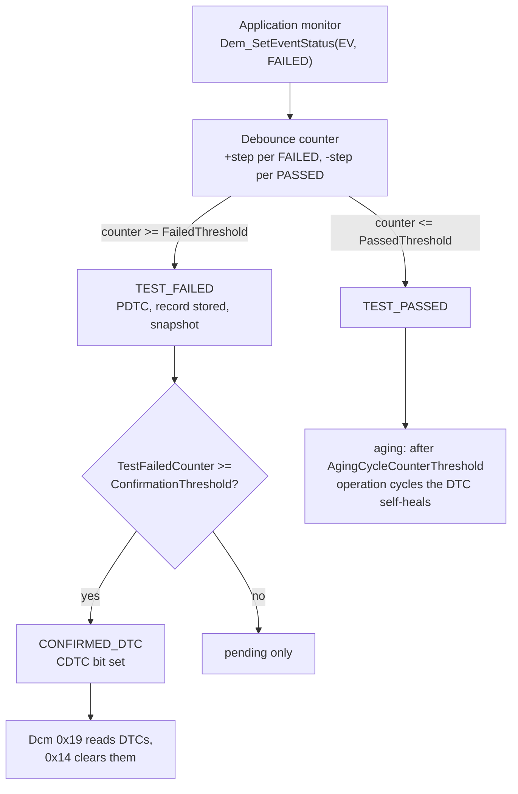
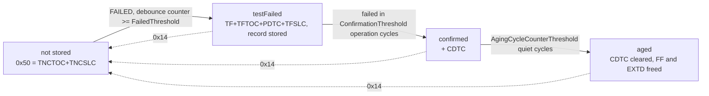

# Dem - Diagnostic Event Manager (DTC storage)

> **In one sentence:** the application reports event pass/fail to Dem; Dem debounces
> them into UDS status bytes, stores DTCs with freeze frames and extended data into
> event memories, and serves them to Dcm (0x14 / 0x19).

| Item | Value |
| --- | --- |
| Module | `infras/diagnostic/Dem` (API: `infras/include/Dem.h`) |
| Layer | Below Dcm (0x14/0x19), above the application monitors |
| Configuration | `app/app/config/Dcm/Dem.json` |
| Generator | `tools/generator/Dem.py` -> `GEN/Dem_Cfg.c` / `GEN/Dem_Cfg.h` |
| Standard | AUTOSAR CP 4.4 Dem (subset) |
| Demo | `CanApp` - routine `31 01 DEED` (`Dem_TestStart`) triggers a synthetic event |

**Contents**

1. [What the module is for](#1-what-the-module-is-for)
2. [How it works at runtime](#2-how-it-works-at-runtime)
3. [Status and freeze-frame data management](#3-status-and-freeze-frame-data-management)
4. [Configuration](#4-configuration)
5. [Public API](#5-public-api)
6. [Build and run a demo](#6-build-and-run-a-demo)
7. [Key notes and gotchas](#7-key-notes-and-gotchas)
8. [Troubleshooting](#8-troubleshooting)

---

## 1. What the module is for

* **Event status tracking** - `Dem_SetEventStatus(EventId, PASSED/FAILED/...)`
  feeds a counter-based debouncing state machine.
* **DTC storage** - a DTC record is written into one or more event memories
  (Primary, Mirror) as soon as its first test-failed edge makes it *pending*,
  with UDS status byte, occurrence counter and aging; confirmation later only
  adds the CDTC bit (section 3.3).
* **Freeze frames** - a snapshot of configured environment data at failure time.
* **Extended data** - per-DTC additional records (e.g. occurrence counter) filled
  by application callbacks.
* **DTC service backend** - Clear DTC (0x14), Read DTC (0x19 sub-functions
  0x01/0x02/0x04/0x06/0x0A...), DTC setting control (0x85).

What it does **not** do: no bus I/O (Dcm is the only client), no monitor
algorithms (the application decides pass/fail).

### 1.1 Several events are grouped into one DTC

The configuration is a **DTC table**: every `DTCs[]` entry owns a list of
**events** (`Events[]`), and the DTC is the only thing that is stored, reported
and cleared - the events are just the monitors that can set it.

| Layer | Generated symbols | Cardinality | What lives there |
| --- | --- | --- | --- |
| Event | `DEM_EVENT_ID_<name>`, `Dem_EventConfigs[]`, `Dem_EventStatusRecords[]` | one per `Events[]` entry | debounce counter, event-level UDS status byte, confirmation counter |
| DTC | `Dem_Dtcs[]` (`EventIdRefs[]`, `NumOfEvents`, `DtcId`) | one per `DTCs[]` entry | DTC number, severity, memory destinations, DTC-level status byte, occurrence / aging counters, freeze frame + extended data |

* A single-event DTC is the degenerate case `Events: [{Name: X}]`: one monitor,
  event and DTC edges coincide.
* A **combined DTC** (`DTC_COMB0` in the demo, 3 events) is still **one** DTC
  entry. Each event debounces on its own; the DTC byte is recomputed as the OR
  of its events (`Dem_UpdateDtcStatus()`, @SWS_Dem_00441):

```c
for (i = 0; i < dtcRef->NumOfEvents; i++)
  status |= EventStatusRecords[dtcRef->EventIdRefs[i]]->Status;
```

  So the DTC turns *pending* as soon as **any** of its events fails, and
  *confirmed* as soon as **any** of them is confirmed, while a recovery is only
  visible at DTC level once **all** of them have passed
  (`Dem_EventUpdateOnPass()`). Freeze frame, extended data, occurrence counter
  and aging counter are per DTC, so a combined DTC keeps **one** snapshot and
  **one** aging history - per-event detail exists only in the event bytes.
* 0x19 reports one line per `DTCs[]` item (never one per event) and 0x14 clears
  all events of the DTC together.
* Event ids are numbered in JSON order - DTC by DTC, then `Events[]` order - so
  reordering the JSON silently renumbers `DEM_EVENT_ID_*` (section 7).

### 1.2 Where the logic lives in `Dem.c`

| Concern | Entry point | Helpers |
| --- | --- | --- |
| Startup / NvM restore | `Dem_Init()` - `Dem_PreInit()` is a stub, NvM restores the blocks by itself | `Dem_EventInit()`, `Dem_DtcOrderQueueInit()` |
| Report and debounce | `Dem_SetEventStatus()` | `Dem_SetEventStatusDebounce()`, `Dem_EventUpdateOnFailed()` / `_OnPass()` |
| Event -> DTC aggregation | `Dem_UpdateDtcStatus()` | OR over `EventIdRefs[]` + the two TNCSLC/TNCTOC fix-ups |
| Storage, counters, snapshots | `Dem_DtcUpdateOnFailed()` | `Dem_TrigerStoreFreezeFrame()`, `Dem_TrigerStoreExtendedData()`, `Dem_HandleDtcDisplacement()` |
| Freeze-frame / extended-data pool | `Dem_MallocFreezeFrameRecord()`, `Dem_MallocExtendedDataRecord()` | `Dem_GetNextRecordNumber()`, `Dem_FillSnapshotRecord()`, `Dem_FreeFreezeFrameRecord()` |
| Operation cycles and aging | `Dem_SetOperationCycleState()`, `Dem_RestartOperationCycle()` | `Dem_StartOperationCycle()`, `Dem_StopOperationCycle()`, `Dem_DtcUpdateOnOperationCycleStop()` |
| Readout for Dcm 0x19 | `Dem_SetDTCFilter()`, `Dem_GetNextFilteredDTC()` | `Dem_IsFilteredDTC()`, `...AndFDC`, `...AndSeverity`, `Dem_GetNextFilteredRecord()` |
| Clear (0x14) | `Dem_ClearDTC()` | frees FF/EXTD slots, resets status records to `0x50`, re-inits monitors |
| Occurrence order (3.7) | `Dem_GetDTCAndStatusByOccurrenceTime()` | `Dem_FailedOrderQueueInsert()`, `Dem_ConfirmedOrderQueueAppend()`, `Dem_DtcOrderQueueRemove()` |
| Persistence | `NvM_WriteBlock()` when the cared bits change | one NvM block per record (3.5) |

---

## 2. How it works at runtime



* **Operation cycles** (`IGNITION` etc.) gate aging and occurrence counting:
  `Dem_RestartOperationCycle()` / `Dem_SetOperationCycleState()`.
* **Enable conditions** (`Conditions` in the JSON, e.g. `BatteryNormal`) must be
  reported `TRUE` via `Dem_SetEnableCondition()` before events are processed.
* **Storage conditions** are **not** implemented: `Dem_SetStorageCondition()` is
  declared in `Dem.h` but has no body, so nothing gates the
  writes today.
* **DTC setting** (`0x85` -> `Dem_DisableDTCSetting()` / `Dem_EnableDTCSetting()`)
  is the one gate that exists: while disabled every `Dem_SetEventStatus()`
  returns `E_NOT_OK` without touching a record (`Dem.c:1652`).
* **DTC-level edges** (TF 0->1, CDTC 0->1) do three things: update the DTC
  byte, store / capture data, and stamp the occurrence-order queues that answer
  0x19 0x0B-0x0E (section 3.7).

---

## 3. Status and freeze-frame data management

Dem keeps **four kinds of records**, all statically allocated by the generator -
nothing is dynamic. The generator writes the arrays and the NvM block table;
the runtime only moves bits and counters inside them. 0x19 0x01/0x02 read a DTC
status record, 0x19 0x04 a freeze-frame sub-slot and 0x19 0x06 the extended
data; 0x14 clears the group and frees its slots.

### 3.1 Record tiers

| Record | Cardinality | Fields | Persistence |
| --- | --- | --- | --- |
| `Dem_EventStatusRecordType` | one per **event** (`DTC_ENVENT_NUM`) | `Status` (UDS byte), `TestFailedCounter` (incremented on every event-level TF 0->1 edge, reset at a cycle stop that saw no failure; `>= ConfirmationThreshold` sets CDTC) | one NvM block per event (2 B) |
| `Dem_DtcStatusRecordType` | one per **DTC per memory** (Primary, Mirror) | `Status` (aggregate), `FaultOccurrenceCounter`, `AgingCounter`, `AgedCounter` (+ `CyclesSinceLastFailed` when enabled) | one NvM block per DTC and memory (4 B) |
| `Dem_FreezeFrameRecordType` | pool per memory, array size `min(NumOfDtcs, DEM_MAX_FREEZE_FRAME_RECORD)` - one slot per DTC by default (`DEM_MAX_FREEZE_FRAME_RECORD` defaults to the number of *events*) | `DtcId` + `MaxFreezeFrameNum` sub-slots of `[record number, snapshot bytes]` | one NvM block per slot (2 + `MaxNum` × 13 B here) |
| `Dem_ExtendedDataRecordType` | same pool sizing rule | `DtcId` + `[record number, extended data bytes]` | one NvM block per slot |

`Dem_EventContextType` (monitor status after debounce, `DebounceCounter`,
capture flags) and `demContext` (DTC filter, enable conditions, DTC-setting
state) are **RAM only**: rebuilt at operation-cycle start, zeroed by `Dem_Init()`
and by 0x14.

### 3.2 One status byte, two owners

The **event-level** byte is written by the event update handlers that the
debounce transition triggers (`Dem_EventUpdateOnFailed()` /
`Dem_EventUpdateOnPass()`, section 2); it is the only place that knows which
monitor won or lost.

The **DTC-level** byte is recomputed by `Dem_UpdateDtcStatus()` (@SWS_Dem_00441)
every time an event of that DTC changes:

```c
status = 0;
for each event of the DTC: status |= EventStatus->Status;
if (status & TFSLC) status &= ~TNCSLC;   /* "failed since clear" and "not complete since clear" are exclusive */
if (status & TFTOC) status &= ~TNCTOC;   /* ditto for this operation cycle */
StatusRecord->Status = status;           /* 0x19 0x01/0x02 report this byte, masked */
```

So the DTC byte is a pure OR of its events with two mutual-exclusion fix-ups;
a combined DTC is confirmed as soon as any of its events is confirmed.

| Bit | Name | Set by | Cleared by |
| --- | --- | --- | --- |
| 0x01 | testFailed (TF) | debounce reaches `FailedThreshold` | debounce reaches `PassedThreshold`, operation-cycle start (unless `DEM_STATUS_BIT_STORAGE_TEST_FAILED`), 0x14 |
| 0x02 | testFailedThisOperationCycle (TFTOC) | same | operation-cycle start only - a PASSED report leaves it set, so the cycle keeps counting as failed |
| 0x04 | pendingDTC (PDTC) | same | operation-cycle stop when the cycle saw no failure, 0x14 |
| 0x08 | confirmedDTC (CDTC) | `TestFailedCounter >= ConfirmationThreshold` | aging complete, 0x14 |
| 0x10 | testNotCompletedSinceLastClear (TNCSLC) | init, 0x14 | any FAILED report |
| 0x20 | testFailedSinceLastClear (TFSLC) | any FAILED report | 0x14, aging complete (`DEM_STATUS_BIT_HANDLING_TEST_FAILED_SINCE_LAST_CLEAR == AGING_AND_DISPLACEMENT`) |
| 0x40 | testNotCompletedThisOperationCycle (TNCTOC) | operation-cycle start | any FAILED report |
| 0x80 | warningIndicatorRequested (WIR) | not driven by this subset | - |

### 3.3 Lifecycle of a DTC



1. **Report** - `Dem_SetEventStatus()` runs the counter-based debounce; reaching
   `FailedThreshold` calls `Dem_EventUpdateOnFailed()` (@SWS_Dem_01199/01207).
2. **Event byte** - TF | TFTOC | PDTC | TFSLC set, TNCTOC | TNCSLC cleared,
   `TestFailedCounter` incremented, CDTC added once the threshold is reached,
   dirty -> NvM write of that event block.
3. **DTC byte** - for **every** memory in `Destination[]`,
   `Dem_DtcUpdateOnFailed()`: `AgingCounter = 0`, occurrence counter per
   `OccurrenceCounterProcessing`, snapshot capture per `FreezeFrameRecordTrigger`,
   dirty -> NvM write of that DTC block.
4. **Recovery** - a PASSED report clears TF, TNCTOC and TNCSLC on the event
   (TFTOC stays set until the next operation-cycle start, so the cycle is still
   recorded as failed); the DTC byte is recomputed only when *all* events of the
   DTC have passed (`Dem_EventUpdateOnPass`).
5. **Aging** - at operation-cycle stop, a DTC whose byte has neither TFTOC nor
   TNCTOC (no failure during the cycle) loses PDTC; if it is CDTC and
   `AgingAllowed`, `AgingCounter++` per quiet cycle; at
   `AgingCycleCounterThreshold` CDTC is cleared, occurrence and aging counters
   reset, `AgedCounter++`, and the freeze-frame + extended-data records of that
   DTC are **freed** (@SWS_Dem_00498/01075).
6. **Clear** - `Dem_ClearDTC()` (0x14) wipes the matched DTC status records to
   `0x50` (TNCTOC | TNCSLC), zeroes the event contexts, sets the event records
   to the same `0x50` with `TestFailedCounter = 0`, frees
   the freeze-frame and extended-data slots of the group, and calls each
   `DemCallbackInitMForE(DEM_INIT_MONITOR_CLEAR)`.

### 3.4 Freeze-frame pool

* **Static pool, one slot per DTC by default.** The pool holds
  `min(NumOfDtcs, DEM_MAX_FREEZE_FRAME_RECORD)` slots per memory
  (`DEM_MAX_FREEZE_FRAME_RECORD` defaults to the number of events, hence one slot
  per DTC). Displacement by `Priority` exists but only matters if the pool is
  deliberately made smaller than the DTC table.
* **Allocation** (`Dem_MallocFreezeFrameRecord`): reuse the slot already owned by
  the DTC -> otherwise the first free slot (`DtcId == 0xFFFF`) -> otherwise
  displace the lowest-priority DTC (and, with
  `DEM_RESET_CONFIRMED_BIT_ON_OVERFLOW`, clear its PDTC/CDTC).
* **Sub-slots**: up to `MaxFreezeFrameNum` (2 in the demo) records per DTC. A new
  record takes the first free sub-slot; when all are taken the **last one is
  overwritten**, so the newest snapshot wins and no ring counter is kept.
* **Record number**: always generated as `DEM_FF_RECNUM_CONFIGURED`, so numbers
  come from `FreezeFrameRecNums` (default `1..MaxFreezeFrameNum`) and the last
  listed number repeats when full. `Dem_GetNextRecordNumber()` also computes a
  `numOfRecs + 1` value, but the generated configuration never selects that mode.
* **Snapshot content**: `FreezeFrameData[slot][0]` is the record number; the rest
  are the **raw values** of the DTC's `Environments` (a per-DTC `Environments[]`
  overrides the global list) stored in ascending `Id` order, fixed size
  `DEM_MAX_FREEZE_FRAME_DATA_SIZE`. The 2-byte DID is *added at readout* by
  `Dem_FillSnapshotRecord()` - that is why 0x19 0x04 costs `4 + Sum(2 + size)`
  bytes per record while storage costs `1 + Sum(size)`.
* **When**: `FreezeFrameRecordTrigger` = `TEST_FAILED` (TF 0->1), `PENDING`
  (PDTC 0->1), `CONFIRMED` (CDTC 0->1) or `EVERY_TEST_FAILED`. Capture runs
  synchronously inside `Dem_SetEventStatus()`: the generator hard-codes
  `EnvironmentDataCapture = DEM_CAPTURE_SYNCHRONOUS_TO_REPORTING` and offers no
  JSON key for it. The deferred path (`DEM_EVENT_FLAG_CAPTURE_FF` executed by
  `Dem_MainFunction()`, @SWS_Dem_00461) is implemented in `Dem.c` but no
  configuration selects it.
* **Freed by**: aging completion, 0x14, or displacement. A DTC whose trigger
  never fired keeps no snapshot, so 0x19 0x04 has nothing to report even for a
  confirmed DTC.
* Extended data follows exactly the same pool rules, with `ExtendedData[0]` as
  the record number and `ExtendedDataRecordTrigger` as the trigger.

### 3.5 Persistence rule

The NvM block is written *when* the record matters, not *what* changed:

```c
/* Dem_Priv.h - DEM_NVM_STORE_TEST_FAILED is 0 unless
 * DEM_STATUS_BIT_STORAGE_TEST_FAILED is defined */
#define DEM_NVM_STORE_CARED_BITS \
  (PDTC | CDTC | TNCSLC | TFSLC | WIR | DEM_NVM_STORE_TEST_FAILED)
...
if ((oldStatus & DEM_NVM_STORE_CARED_BITS) != (StatusRecord->Status & DEM_NVM_STORE_CARED_BITS))
  NvM_WriteBlock(...);   /* the whole record block, counters included */
```

Consequences worth knowing before changing the record layout:

* TF (bit 0) is only stored when `DEM_STATUS_BIT_STORAGE_TEST_FAILED` is
  defined; TNCTOC (bit 6) is never compared. Both come back through the
  operation-cycle start instead (TNCTOC set, TF cleared).
* `FaultOccurrenceCounter`, `AgingCounter`, `AgedCounter` are not compared
  either: they are only persisted when another cared bit changes in the same
  update (or at aging completion, where the dirty flag is raised explicitly).
* One block per record -> one failure costs 1 event-block write +
  `NumOfMemoryDestination` DTC-block writes + optionally 1 freeze-frame write +
  1 extended-data write. There is no "whole memory image" block.
* The block length is **not** `sizeof(Dem_...RecordType)`. `NvM.json` describes
  each block field by field (`Data[]`), the NvM generator emits its own
  `Dem_Nvm...Type` struct and `NvM_Cfg.c` uses `sizeof()` of *that* type while
  pointing at the Dem record object (`extern Dem_DtcStatusRecordType
  Dem_NvmPrimaryDtcStatusRecord0_Ram;`). Adding a field to
  `Dem_DtcStatusRecordType` therefore does **not** change the block layout - the
  matching entry in `NvM.json` has to be extended by hand, otherwise the two
  views of the same RAM disagree on the size. Any layout change also invalidates
  the content of ECUs flashed with the previous layout.

### 3.6 What the stored data cannot tell you

Keep this in mind when a diagnostic feature asks for "the first" or "the most
recent" DTC:

1. **There is no time base and no occurrence order in the records.**
   `Dem_DtcStatusRecordType`
   holds a status byte and three counters - no timestamp, no global sequence
   number, no "when did it last fail" value. `Dem.c` has no time source
   dependency either.
2. **The only ordering in the records is the configuration order.**
   `Dem_GetNextFilteredDTC()` walks `demContext.Filter.Index .. NumOfDtcs-1`,
   i.e. the order of `DTCs[]` in `Dem.json`. "Lowest index" and "highest index"
   are stable but unrelated to when a fault occurred (the occurrence order lives
   in the separate queues of 3.7).
3. **The status byte is a snapshot, not a history.** After a DTC recovers, only
   TFSLC (bit 5) still proves "it failed since the last clear"; TF and PDTC are
   gone. After aging or 0x14 even TFSLC is gone. So a first/most-recent-failure
   query cannot be answered by inspecting the records after the fact - the
   information has to be captured when the transition happens.
4. **The records cannot answer "first / most recent" - a separate queue does.**
   `Dem_GetDTCByOccurrenceTime()` (@SWS_Dem_00218) is implemented on top of two
   ordered DtcId queues (section 3.7), it does not inspect the status records:
   the queues are stamped on the TF / CDTC 0->1 edges and live in their own NvM
   blocks. When the feature is switched off, or when the mapped queue is empty,
   Dcm rejects 0x0B-0x0E with `requestOutOfRange` (0x31) instead of inventing an
   answer from the configuration order.
5. **The freeze-frame pool is indexed by DTC, not by time.** Slot order and
   record numbers are per DTC ("1st, 2nd snapshot of this DTC"), so neither can
   order different DTCs.
6. **`AgedCounter` and `FaultOccurrenceCounter` are monotonic counters, not
   clocks.** They can rank by count, not by recency.
7. **The one place that distinguishes "occurred" from "currently active"** is
   the TF 0->1 edge in `Dem_DtcUpdateOnFailed()` and the CDTC 0->1 edge below it -
   that is exactly where the order queues are stamped (section 3.7).

### 3.7 Occurrence-order tracking for 0x19 0x0B-0x0E

The four "first / most recent" services are answered from two ordered **DtcId
queues** that are stamped on the DTC-level edges - never from the status
records of 3.6, which have no time base.

There are only two real timelines: the order in which DTCs **failed** and the
order in which they were **confirmed**. All four 0x19 results are head/tail
views of these two timelines, so the data model is two queues, not four lists,
each behind its own compile switch.

"first failed" and "most recent failed" need *different* orderings once
re-failures happen (fail -> recover -> re-fail), and a naive single queue cannot
hold both. The resolution is a **history queue**: every TF 0->1 edge is recorded
in time order and each DTC keeps exactly **two** of its edges - its **first** and
its **most recent** (one entry while the two coincide). The head of the queue is
then always the first failed DTC and the tail always the most recent one.

For the TF edges `D1 D2 D1 D2 D1` the queue evolves like this (`0xFFFF` marks the
first free entry = terminator):

| TF 0->1 edge | Q1 content, head ... tail | why | 0x0B | 0x0D |
| --- | --- | --- | --- | --- |
| `D1` | `D1` | not tracked yet -> append | D1 | D1 |
| `D2` | `D1 D2` | not tracked yet -> append | D1 | D2 |
| `D1` | `D1 D2 D1` | one entry (first = latest) -> append | D1 | D1 |
| `D2` | `D1 D2 D1 D2` | one entry (first = latest) -> append | D1 | D2 |
| `D1` | `D1 D2 D2 D1` | two entries -> erase the stale latest, append | D1 | D1 |

So the head is always the oldest surviving edge (= first failed) and the tail the
newest one (= most recent), and a DTC occupies one entry while both coincide and
two afterwards. Q2 (confirmed order) is the trivial case: a CDTC 0->1 edge can
happen only once per DTC, so it is a plain append with capacity `NumOfDtcs`.

#### Data model

`Dem_DtcOrderQueueConfigType` in `Dem_Priv.h` - the queues are pointers into the
NvM Ram blocks, so their size is defined by the NvM configuration:

```c
/* Dem_Priv.h */
#if defined(DEM_USE_FAILED_DTC_ORDER_QUEUE) || defined(DEM_USE_CONFIRMED_DTC_ORDER_QUEUE)
typedef struct {
#ifdef DEM_USE_FAILED_DTC_ORDER_QUEUE
  CONSTP2VAR(uint16_t, AUTOMATIC, DEM_CONST)
  FailedOrderQueue;                        /* 2 * NumOfDtcs entries */
  uint16_t FailedOrderQueueNvmBlockId;
#endif
#ifdef DEM_USE_CONFIRMED_DTC_ORDER_QUEUE
  CONSTP2VAR(uint16_t, AUTOMATIC, DEM_CONST)
  ConfirmedOrderQueue;                     /* NumOfDtcs entries */
  uint16_t ConfirmedOrderQueueNvmBlockId;
#endif
} Dem_DtcOrderQueueConfigType;
#endif
```

* Two instances: **Q1 failed-order queue** (`2 * NumOfDtcs` entries) and **Q2
  confirmed-order queue** (`NumOfDtcs` entries), one NvM block each.
* **No Count field.** The blocks default to all-`0xFFFF`, so an untouched
  block is an empty queue; the first `0xFFFF` entry terminates the valid part
  (head = index 0, tail = last entry before the terminator).
* Q1 invariant: entries are in chronological order of TF 0->1 edges and every
  stored DtcId has **at most two** entries - its first and its most recent
  failure edge. A third occurrence erases the stale middle one. Combined DTCs
  are stamped at **DTC level** (on the DTC status edge), never per event.

#### Update rules

| Object | Update point | Already present | Serves |
| --- | --- | --- | --- |
| Q1 failed order | TF 0->1 edge in `Dem_DtcUpdateOnFailed()` -> `Dem_FailedOrderQueueInsert()` | 0 entries: append; 1 entry (first = latest): append again (now first + latest); 2 entries: erase the latest entry, append at the tail | 0x0B first failed = head, 0x0D most recent failed = tail |
| Q2 confirmed order | CDTC 0->1 edge -> `Dem_ConfirmedOrderQueueAppend()` | cannot happen - the edge implies the DTC was not confirmed | 0x0C first confirmed = head, 0x0E most recent confirmed = tail |

Both edges are stamped only for the **first configured memory destination**
(`0u == origin` in `Dem_DtcUpdateOnFailed()`), i.e. once per DTC even when it is
stored in Primary and Mirror.

**Why the `2 * NumOfDtcs` capacity can never overflow:** the occupancy equals the
sum over all DTCs of `min(failure-edge count, 2) <= 2 * NumOfDtcs`. An edge
raises that sum by at most one and the 2->2-entry transition is
occupancy-neutral, so an append is never refused. `Dem_OrderQueueAppend()`
therefore does not need a "queue full" error path.

**A re-failure must not overwrite the latest-entry slot in place** - that would
break the chronological order (in `[D1@t1, D2@t2, D1@t3, D2@t4]` an in-place
overwrite leaves a stale tail at the end). `Dem_FailedOrderQueueInsert()` erases
the latest entry from the middle (`Dem_OrderQueueRemoveAt()`) and appends at the
tail.

**Removal rule (the key property):** whenever a DTC's stored state is erased,
**all** entries of its DtcId are removed from **both queues** while the remaining
order is preserved - the next-in-order automatically becomes the new first /
most recent. `Dem_DtcOrderQueueRemove()` is called from:

* aging completion (@SWS_Dem_00498/01075),
* `Dem_ClearDTC()` (0x14), per matched DTC,
* displacement that resets CDTC (`DEM_RESET_CONFIRMED_BIT_ON_OVERFLOW`).

#### Readout

`Dem_GetDTCAndStatusByOccurrenceTime(clientId, kind, *DTC, *status)` maps the
kind to Q1 head (0x0B), Q1 tail (0x0D), Q2 head (0x0C) or Q2 tail (0x0E) and
also returns the DTC's current UDS status byte, taken from the **Primary**
memory record (the first memory if no Primary exists) and not masked with
`StatusAvailabilityMask`; `Dem_GetDTCByOccurrenceTime()`
(@SWS_Dem_00218) is the thin standard wrapper around it. Return values:

| Situation | Return |
| --- | --- |
| queue holds an answer | `E_OK`, DTC + status filled |
| mapped queue is empty | `DEM_NO_SUCH_ELEMENT` |
| feature compiled out | `E_NOT_OK` |
| `NULL` pointer argument | `E_NOT_OK` |

`Dcm_DspReportFirstOrMostRecentDTC()` answers from it only - there is **no**
config-index fallback: every failure (`DEM_NO_SUCH_ELEMENT` or `E_NOT_OK`) is
reported to the tester as `requestOutOfRange` (0x31), a wrong-length request as
`0x13`, and a too-small response buffer as `0x14` (`responseTooLong`).

#### Configuration

| JSON key (`Dem.json`) | Generated macro | Default | Serves |
| --- | --- | --- | --- |
| `UseFailedDtcOrderQueue` | `DEM_USE_FAILED_DTC_ORDER_QUEUE` | `false` | Q1 -> 0x19 0x0B / 0x0D |
| `UseConfirmedDtcOrderQueue` | `DEM_USE_CONFIRMED_DTC_ORDER_QUEUE` | `false` | Q2 -> 0x19 0x0C / 0x0E |

When a switch is off the generator omits that queue and the matching
`Dem_DtcOrderQueue` member (drop the block from `NvM.json` too), so it costs no
RAM and its 0x19 pair answers `0x31`.

**NvM integration** (general rules in 3.5):

* Two blocks in `NvM.json` - `Dem_NvmDtcFailedOrderQueue`
  (`2 * NumOfDtcs` x `uint16`) and `Dem_NvmDtcConfirmedOrderQueue`
  (`NumOfDtcs` x `uint16`), both with the default `[0xFFFF]*n`. These entries
  are written **by hand**: the Dem generator only consumes them, it does not
  create the blocks, so the `Repeat` count has to follow `NumOfDtcs` manually
  when DTCs are added (6 DTCs -> `Repeat: 12` and `Repeat: 6` in the demo).
* Write-on-change: every append / erase-and-append / removal issues one
  `NvM_WriteBlock()` with the block id from the generated `Dem_DtcOrderQueue`.
* `Dem_Init()` -> `Dem_DtcOrderQueueInit()` validates the restored content
  (`Dem_OrderQueueIsValid()`): every id in the valid part is in range
  (`< NumOfDtcs`) and appears at most twice in Q1 (once in Q2); everything after
  the first `0xFFFF` is ignored. Corrupt content is reset to all-`0xFFFF` with a
  `DEME` log - the history cannot be rebuilt from anywhere else. The reset
  happens in the NvM Ram image only: the block is rewritten on the next queue
  update, so a corrupt image logs once per boot until something changes it.
* Like any record-layout change, enabling the feature invalidates content
  flashed with the previous layout.

**Deliberate deviations from a strict reading of the standard:**

1. **Aging removes entries.** ISO 14229-1 scopes the answers to "since the last
   clear", so an aged-out DTC would still be an answer; here the answer becomes
   "oldest / newest DTC still stored", which keeps it consistent with what 0x19
   0x02/0x0A actually report.
2. **The queues are global, not per memory destination.** Occurrence time is not
   a per-memory concept and 0x19 0x0B-0x0E carry no DTCOrigin.
3. **Zero RAM/timing cost when off.** Both switches off = the pre-existing
   behaviour except that 0x0B-0x0E answer `0x31` instead of the configuration
   index.

---

## 4. Configuration

### 4.1 Top-level keys

| Key | Default | Meaning |
| --- | --- | --- |
| `Memories[]` | `[{Name: Primary, Origin: 0x0001}]` | Event memories; `Origin` is the DTCOrigin used by 0x19 (1=Primary, 2=Mirror...) |
| `General` | see 4.2 | Debounce/aging/confirmation policy |
| `DTCs[]` | required | DTC table (see 4.3) |
| `Environments[]` | required, may be `[]` | Freeze-frame (FFD) data records - the generator indexes the key directly |
| `ExtendedDatas[]` | required, may be `[]` | Extended data (EXTD) records, same |
| `MaxFreezeFrameNum` | **2** | Freeze-frame records per DTC |
| `StatusAvailabilityMask` | **0x7F** | Which UDS status bits are supported |
| `UseFailedDtcOrderQueue` | **false** | Emits `DEM_USE_FAILED_DTC_ORDER_QUEUE`: Q1 for 0x19 0x0B / 0x0D (3.7) |
| `UseConfirmedDtcOrderQueue` | **false** | Emits `DEM_USE_CONFIRMED_DTC_ORDER_QUEUE`: Q2 for 0x19 0x0C / 0x0E (3.7) |
| `UsePostBuildConfig` | **false** | Emits `DEM_USE_PB_CONFIG` |

### 4.2 `General`

| Key | Demo value | Meaning |
| --- | --- | --- |
| `DebounceCounterFailedThreshold` | 10 | Counter value that sets TEST_FAILED |
| `DebounceCounterPassedThreshold` | -10 | Counter value that sets TEST_PASSED |
| `DebounceCounterIncrementStepSize` / `DecrementStepSize` | 1 / 2 | Step per FAILED / PASSED report |
| `DebounceCounterJumpDown` / `JumpDownValue` | false / 0 | Jump directly to a value when passing |
| `DebounceCounterJumpUp` / `JumpUpValue` | true / 0 | Jump when failing |
| `ConfirmationThreshold` | 2 | Number of failed reports (TF 0->1 edges) before a DTC gets CDTC - in practice one per failed operation cycle, but a re-failure inside the same cycle counts again |
| `AgingCycleCounterThreshold` | 5 | Passed operation cycles before a confirmed DTC ages out |
| `OccurrenceCounterProcessing` | `"TF"` | Count occurrences on TEST_FAILED |
| `FreezeFrameRecordTrigger` | `"TEST_FAILED"` | When to snapshot the freeze frame |
| `ExtendedDataRecordTrigger` | `"TEST_FAILED"` | When to update extended data |

### 4.3 `DTCs[]`

| Key | Meaning |
| --- | --- |
| `Name` | Symbol name - generates `DEM_EVENT_ID_<NAME>`; combined DTCs hold several events via `Events[]` |
| `Number` | 3-byte DTC number, e.g. `"0x112200"` |
| `Conditions` | Enable-condition names; the union of all names generates `DEM_NUM_OF_ENABLE_CONDITION` |
| `Destination` | Memories to store into, e.g. `["Primary", "Mirror"]` |
| `Priority` | Lower value = higher priority; only used to pick the victim when the freeze-frame / extended-data pool is full |
| `OperationCycleRef` | Cycle name, default `IGNITION` |
| `Events[]` | Optional sub-events of a combined DTC (`DTC_COMB0` in the demo) |
| `Environments` / `FreezeFrameRecNums` | Per-DTC override of the freeze-frame content/record numbers |

### 4.4 `Environments[]` / `ExtendedDatas[]`

Each record is `{Name, Id, Type, Unit?}` (`uint8`/`uint16`/...). For every record
the generator **declares a callback the application must implement**:

```c
Std_ReturnType Dem_FFD_GetBattery(Dem_DtcIdType EventId, uint8_t *data, Dem_DTCOriginType DTCOrigin);
Std_ReturnType Dem_EXTD_GetFaultOccuranceCounter(Dem_DtcIdType EventId, uint8_t *data, Dem_DTCOriginType origin);
```

Missing implementations are link errors; wrong `Type` size corrupts the record
layout.

---

## 5. Public API

| Function | Caller | Purpose |
| --- | --- | --- |
| `Dem_Init(ConfigPtr)` | EcuM | Activate the configuration, re-init the events and validate the order queues. `Dem_PreInit()` is an empty stub, `Dem_Shutdown()` is not implemented |
| `Dem_SetEventStatus(EventId, status)` | application monitors | Report `PASSED` / `FAILED` / `PREPASSED` / `PREFAILED` |
| `Dem_SetEnableCondition(id, bool)` | application | Report `BatteryNormal` etc. |
| `Dem_SetOperationCycleState` / `Dem_RestartOperationCycle(id)` | application / EcuM | Drive `IGNITION` cycle |
| `Dem_GetEventUdsStatus(EventId, *byte)` | application | Current UDS status byte |
| `Dem_GetFaultDetectionCounter(EventId, *counter)` | application | Fault detection counter scaled onto the UDS range -128..127 (`Dem_GetFDCOfDTC()` does the same for a DTC) |
| `Dem_SetDTCFilter` / `Dem_GetNumberOfFilteredDTC` / `Dem_GetNextFilteredDTC` (+ `AndFDC`, `AndSeverity`) | Dcm 0x19 | DTC report iteration |
| `Dem_SetFreezeFrameRecordFilter` / `Dem_GetNumberOfFreezeFrameRecords` / `Dem_GetNextFilteredRecord` | Dcm 0x19/0x04 | Freeze-frame iteration |
| `Dem_SelectDTC` / `Dem_ClearDTC(ClientId)` | Dcm 0x14 | Clear a DTC in the selected origin |
| `Dem_SelectFreezeFrameData` / `Dem_GetNextFreezeFrameData` | Dcm 0x19/0x04 | Freeze-frame readout |
| `Dem_SelectExtendedDataRecord` / `Dem_GetNextExtendedDataRecord` | Dcm 0x19/0x06 | Extended-data readout |
| `Dem_DisableDTCSetting` / `Dem_EnableDTCSetting(ClientId)` | Dcm 0x85 | Stop/start event storage |
| `Dem_GetDTCStatusAvailabilityMask` | Dcm 0x19 | Status availability mask |
| `Dem_GetDTCByOccurrenceTime(ClientId, kind, *DTC)` / `Dem_GetDTCAndStatusByOccurrenceTime(..., *status)` | Dcm 0x19 0x0B-0x0E | First / most recent failed or confirmed DTC from the order queues (3.7) |
| `Dem_MainFunction()` | scheduler | Only flushes the deferred freeze-frame / extended-data capture flags - no debounce and no aging runs here (aging happens at operation-cycle stop) |

---

## 6. Build and run a demo

```bash
scons --app=CanApp
./build/nt/GCC/CanApp/CanApp.exe
./build/nt/GCC/IsoTpSend/IsoTpSend.exe -v 1902FF      # read DTC status by mask 0xFF
./build/nt/GCC/IsoTpSend/IsoTpSend.exe -v 3101DEED    # routine: Dem_TestStart
./build/nt/GCC/IsoTpSend/IsoTpSend.exe -v 1902FF      # the DTC is now stored
./build/nt/GCC/IsoTpSend/IsoTpSend.exe -v 14FFFFFF    # clear all DTCs
```

The demo DTCs are `0x112200` ... `0x112204` + combined `DTC_COMB0`; the routine
`0xDEED` (`Dem_TestStart`) reports a FAILED event so you can watch the whole
pipeline: event -> debounce -> pending + freeze frame -> confirmed -> 0x19
report -> 0x14 clear.

---

## 7. Key notes and gotchas

1. **Event ids are generated from names** - `DEM_EVENT_ID_DTC0` etc. The
   application includes `Dem_Cfg.h` and reports with these macros; renumbering
   happens silently when DTCs are reordered.
2. **Combined DTCs share one storage entry** - all events of `Events[]` map to
   the same DTC number; any event failing sets the DTC byte and any event
   confirmed confirms the DTC.
3. **Enable conditions must be reported at startup** - with
   `conditions: ["BatteryNormal"]` and no `Dem_SetEnableCondition(0, TRUE)`,
   every event report is ignored.
4. **Aging counts operation cycles, not time** - call
   `Dem_RestartOperationCycle()` on ignition off/on, otherwise a confirmed DTC
   never ages.
5. **FFD/EXTD callbacks must exist for every record** - the generator emits the
   prototypes; the demo implementations live in `app/app/src`.
6. **Memories are backed by NvM** - via the `NvmBlock` hooks of the NvM
   configuration; without a working NvM the memories stay RAM-only (lost on
   reset).
7. **`Priority` matters for overflow** - when a memory is full the lowest
   priority DTC is replaced.

---

## 8. Troubleshooting

| Symptom | Likely cause | Check |
| --- | --- | --- |
| 0x19 returns no DTCs although events fail | enable condition not set, or events still debouncing | `Dem_SetEnableCondition`, `Dem_GetFaultDetectionCounter` |
| 0x14 does not clear | DTC setting disabled (0x85) or wrong DTCOrigin | `Dem_DisableDTCSetting` state, `Origin` |
| Freeze frame empty | `FreezeFrameRecordTrigger` not reached, or FFD callback returns E_NOT_OK | callback return value |
| Link error `Dem_FFD_GetX` | record declared in JSON but not implemented | implement or remove the record |
| DTC gone after reset | NvM not storing the memory block | NvM.json block id, the NvM read-all order (`Dem_PreInit()` is a stub, nothing reads it there) |
| Combined DTC shows one event only | all `Events[]` names identical | DTC JSON |

---

**Related documents:** [Dcm](Dcm.md) - [NvM](NvM.md) - [CanTp](CanTp.md)
