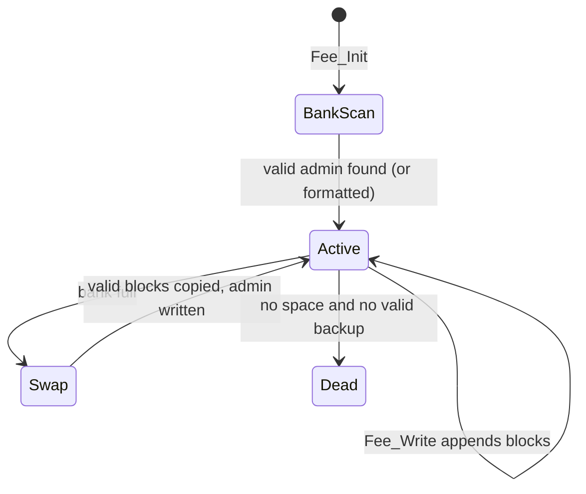

# Fee - Flash EEPROM Emulation

> **In one sentence:** Fee emulates byte-writable EEPROM on top of a
> page-erased flash: blocks are appended with an admin header, a full bank is
> swapped to the next bank in rotation, and stale copies are collected during
> the swap.

| Item | Value |
| --- | --- |
| Module | `infras/memory/Fee` (API: `infras/include/Fee.h`) |
| Layer | Above Fls, below [NvM](NvM.md) (via MemIf) |
| Configuration | generated by `tools/generator/NvM.py` into `GEN/Fee_Cfg.c` (`Fee_Banks[]`), plus `config/NvM/Fls_Cfg.c` (bank addresses) |
| Standard | AUTOSAR CP 4.4 Fee (subset) |
| Demo | `CanApp` with `target: Fee` and `FLS_DIRECT_ACCESS` on the simulator |

**Contents**

1. [What the module is for](#1-what-the-module-is-for)
2. [Configuration](#2-configuration)
3. [How it works at runtime](#3-how-it-works-at-runtime)
4. [Public API](#4-public-api)
5. [Key notes and gotchas](#5-key-notes-and-gotchas)
6. [Known limitations](#6-known-limitations)

---

## 1. What the module is for

* **Append-only block store** - every write appends `{admin header, CRC, data}`
  at the next free page of the active bank; the newest copy wins.
* **Bank swap** - when the active bank is full, valid blocks are copied to the
  next bank in rotation, which then becomes active. "Flash is dead" only when
  all banks are full of valid data.
* **Wear spreading** - because writes are appended, a small block updated often
  does not wear a single flash page.
* **Power-loss safety** - bank and block admin structures carry magic numbers with
  their inverted copies and every block has its own data CRC; a half-written
  block is rejected when it is read (the next older copy, or the block's ROM
  default, is used) and an interrupted swap is re-run at boot.

---

## 2. Configuration

Fee has **no own JSON**; it is configured through the NvM generator:

| Source | Content |
| --- | --- |
| `NvM.json` `target: "Fee"` | selects Fee in `app/app/SConscript` (`Fls_Cfg.c` is added) |
| `NvM.json` `Banks[]` | optional explicit bank table `{Address, Size, Repeat}`; when empty the generator emits the `FLS_BANK0/1_ADDRESS` + `FLS_BANK0/1_SIZE` defaults |
| `NvM.json` `UseContextCrc` / `UseFaults` | emit `FEE_USE_CONTEXT_CRC` / `FEE_USE_FAULTS` |
| `config/NvM/Fls_Cfg.c` | `FLS_BANK0_ADDRESS/SIZE`, `FLS_BANK1_ADDRESS/SIZE` |
| build defines | `FEE_PAGE_SIZE` (default **8**), `FEE_WORKING_AREA_SIZE`, `FLS_ERASED_VALUE` (default 0xFF), `FLS_DIRECT_ACCESS`, `FEE_USE_BLANK_CHECK` |
| generated defaults | `FEE_MAX_JOB_RETRY` (0xFF), `FEE_MAX_ERASED_NUMBER` (1000000), both `#ifndef` guarded in `GEN/Fee_Cfg.c` |

Generated `Fee_Banks[]` (demo):

```c
static CONSTANT(Fee_BankType, FEE_CONST) Fee_Banks[] = {
  {FLS_BANK0_ADDRESS, FLS_BANK0_ADDRESS + FLS_BANK0_SIZE},
  {FLS_BANK1_ADDRESS, FLS_BANK1_ADDRESS + FLS_BANK1_SIZE},
};
```

Any number of banks; they are used in rotation - `Fee_Init` picks the first
bank without a valid admin magic as the working bank, and backup swaps to the
next one circularly.

---

## 3. How it works at runtime



* **Read** - the newest copy address is resolved when the bank is scanned and
  again on demand when a copy turns out to be corrupt; the data is read with
  `Fls_Read` (or directly with `FLS_DIRECT_ACCESS`) and its CRC checked, falling
  back to the next older copy and finally to the block's `Rom` default.
* **Write** - append the block admin at `AdminFreeAddr` and the data (with its
  CRC) at `DataFreeAddr`; the new admin entry makes the previous copy stale, so
  no erase or blank check is needed for an append.
* **Swap** - copy all newest blocks to the next bank in rotation, write its
  admin magic, erase the old bank afterwards.
* `Fee_GetAdminInfo()` exposes the current bank/counter for tests
  (`NvM_Test` prints it).

---

## 4. Public API

| Function | Purpose |
| --- | --- |
| `Fee_Init(ConfigPtr)` | Scan banks, recover state |
| `Fee_Read(BlockNumber, offset, dst, len)` | Async read job |
| `Fee_Write(BlockNumber, src)` | Async append job |
| `Fee_GetStatus()` / `Fee_SetMode(Mode)` | Busy state / forwarded to `Fls_SetMode` |
| `Fee_InvalidateBlock` / `Fee_EraseImmediateBlock(BlockNumber)` | Mark block invalid / erase |
| `Fee_Cancel()` / `Fee_GetJobResult()` | Job control |
| `Fee_JobEndNotification` / `Fee_JobErrorNotification()` | Fls callbacks |
| `Fee_MainFunction()` | Job worker |
| `Fee_GetAdminInfo(*info)` | Bank state introspection (SSAS extension) |
| `Fee_GetVersionInfo` | Version |

---

## 5. Key notes and gotchas

1. **Page size is 8 bytes** (`FEE_PAGE_SIZE`) - small writes cost a whole page
   including admin; do not expect byte-granular efficiency.
2. **Bank sizing is the whole wear-levelling strategy** - each new write
   appends a full block copy, and backup copies every newest block into the
   next bank; the destination bank must hold every block at least once, and
   with only two banks each bank must hold every block (active + swap copy).
3. **`FLS_ERASED_VALUE` must match the flash** - a wrong value corrupts the
   blank checks; the demo sets `FLS_ERASED_VALUE=0xFF` and `FEE_USE_BLANK_CHECK`.
4. **On the simulator** `FLS_DIRECT_ACCESS` maps flash to `g_FlsAcMirror` RAM;
   never enable it on a real target.
5. **Swap time is proportional to valid data** - schedule it away from real-time
   critical phases (NvM jobs run in `NvM_MainFunction` anyway).
6. **"flash is dead" is logged as `FEEE`** - when you see
   `No space left, flash is dead`, all banks are exhausted; enlarge the banks.

---

## 6. Known limitations

1. **No immediate block priority / escape line** - AUTOSAR immediate blocks are
   not special-cased.
2. **`FEE_USE_CONTEXT_CRC` protects the RAM context, not the flash** - it keeps a
   CRC over `Fee_Context` plus the factory context so a corrupted copy panics
   instead of being written back. Block admin and block data always carry their
   own CRC.
3. **No compression, no dedup** - every write appends the full block.
4. **`Fee_SetMode(MemIf_ModeType)` only forwards to `Fls_SetMode()`** - Fee has no
   FAST/SLOW behaviour of its own.

**Related documents:** [NvM](NvM.md) - [Ea](Ea.md)
